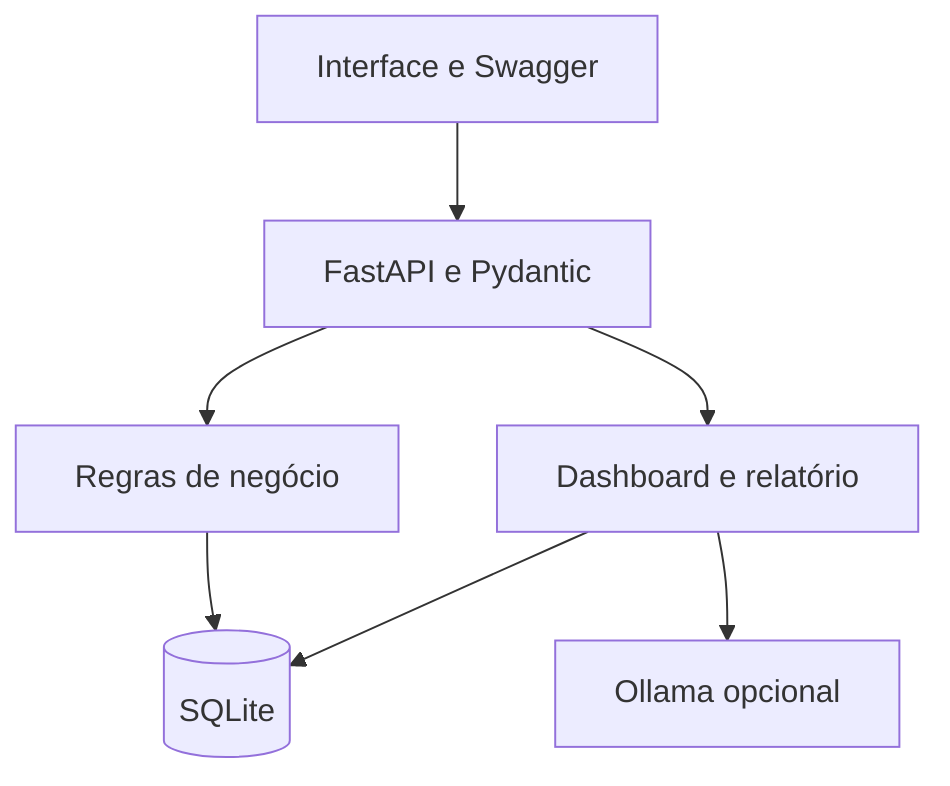

# Prato Cheio - Checkpoint 3

Gestão de doações de alimentos: estabelecimentos publicam lotes e instituições reservam e registram retiradas.
O CP3 acrescenta testes de aceitação com evidências, validação Docker, configuração de deploy e proposta de monetização.

## Integrantes

| Nome | RM |
|---|---|
| Leonardo Viana | 571969 |
| João Paulo Melo | 570118 |
| Pedro Grigorio | 570308 |
| Cauã da Silva Lima | 571023 |

## Links e acesso

- GitHub: https://github.com/Cauasl17/prato-cheio-cp2
- Trello: https://trello.com/b/x4UExcxZ/trello-cp
- Testes e Docker: https://github.com/Cauasl17/prato-cheio-cp2/actions
- Apresentação: [APRESENTACAO_CP3.pptx](APRESENTACAO_CP3.pptx)
- Endereço do deploy: **pendente de publicação na conta de hospedagem**. Procedimento em [docs/cp3/DEPLOY.md](docs/cp3/DEPLOY.md).

O nome do repositório preserva a entrega anterior. Os links 127.0.0.1 abaixo são locais;
o GitHub armazena o código, mas não executa a API permanentemente.

## Arquitetura e funcionalidades

HTML/CSS/JavaScript servido pelo FastAPI. A interface usa fetch com autenticação Bearer.
Routers e schemas recebem/validam dados, `crud.py` aplica regras e SQLAlchemy persiste em SQLite.
Dashboard agrega dados reais do banco. Ollama gera relatório contextual e a aplicação salva a resposta.



Cadastros de doadores, instituições, lotes e reservas. Coleta e cancelamento verificam saldo,
validade, cadastro ativo e refrigeração. Cancelar preserva as quantidades já coletadas.
Listas possuem paginação e filtros. O dashboard separa unidades e alerta sobre validade próxima.

## Execução local

Python 3.11 ou superior. Extrair o ZIP antes de executar os arquivos.
No Windows, executar `INICIAR_WINDOWS.bat`. O terminal permanece aberto para mostrar falhas.
Alternativa manual:

```bash
python -m venv .venv
# Windows:
.venv\Scripts\activate
# Linux/macOS:
source .venv/bin/activate
pip install -r requirements.txt
python iniciar.py
```

Abrir http://127.0.0.1:8000/app . A chave local aparece no terminal de `iniciar.py`.
Swagger: http://127.0.0.1:8000/docs . Usar Authorize e informar essa chave.
Saúde: http://127.0.0.1:8000/health . Resposta esperada: HTTP 200, status e banco iguais a `ok`.

O inicializador cria configuração privada e dados fictícios apenas em banco vazio.
O SQLite é criado automaticamente; os scripts não apagam dados existentes.
O esquema SQL está em `docs/schema.sql`. Evitar bancos de demonstração antigos com lotes vencidos.
Se o navegador mostrar conexão recusada, conferir o terminal e se o servidor ainda está rodando.

## Configuração do ambiente

| Variável | Uso |
|---|---|
| API_TOKEN | Chave administrativa privada. Contêiner exige pelo menos 32 caracteres |
| DATABASE_URL | SQLite local ou `sqlite:////dados/prato_cheio.db` no contêiner |
| PORT | Porta HTTP, padrão 8000. A hospedagem pode fornecer outro valor |
| SEED_DEMO | `true` insere exemplos somente se o banco estiver vazio |
| OLLAMA_URL | URL interna do Ollama. Local: localhost; Compose: http://ollama:11434 |
| OLLAMA_MODEL | qwen2.5:0.5b, após download do modelo |

`.env` e tokens ficam fora do Git e do ZIP. Os logs de contêiner não mostram a chave.
O acesso é administrativo e compartilhado; não há gestão de usuários por instituição.

## Docker

Com Docker Engine/Desktop e Compose instalados:

```bash
python scripts/configurar.py
docker compose build
docker compose up -d
docker compose ps
```

Ler a chave no `.env` local para entrar na aplicação. Para iniciar também a LLM:

```bash
docker compose --profile llm up -d
docker compose logs -f ollama-init
```

Aguardar o download do modelo antes de gerar relatórios. `dados` mantém o banco e `modelos` mantém o modelo.
`docker compose down` encerra sem apagar volumes. Comandos detalhados e evidências em
[docs/cp3/DOCKER.md](docs/cp3/DOCKER.md).

## Testes e evidências

```bash
pip install -r requirements-dev.txt
python -m pytest --junitxml=evidencias/pytest.xml --cov=crud --cov=security --cov=config --cov=routers --cov=services --cov-report=term-missing --cov-report=xml:evidencias/coverage.xml
```

Resultado local em 20/10/2026: **39 testes aprovados**, oito cenários com esperado/obtido e
**80% de cobertura** nos módulos medidos. Os testes usam SQLite temporário separado.
A verificação por HTTP executou 12 requisições com cadastro, erro de saldo, reserva, coleta e dashboard.
O CI construiu e iniciou a imagem Docker, repetiu o fluxo e confirmou persistência após reinício.
Cenários e correções: [docs/cp3/TESTES.md](docs/cp3/TESTES.md). Evidências: `evidencias/`.

Para um serviço já iniciado, com API_TOKEN definido no ambiente do terminal:

```bash
python scripts/smoke.py --exercise --output evidencias/smoke.json
```

O script cria dados fictícios de demonstração. Executar em ambiente de avaliação.
As rotas de saúde, interface e contrato são públicas; operações de negócio exigem a chave.

## API e LLM

| Rotas | Operações |
|---|---|
| /doadores, /instituicoes | GET/POST e GET/PUT/DELETE por ID |
| /doacoes | GET/POST, GET/PUT/DELETE por ID e PATCH /{id}/cancelar |
| /reservas | GET/POST, GET/DELETE por ID e PATCH /{id}/coletar |
| /dashboard | GET de indicadores do banco |
| /health | GET de saúde da API e conexão SQL |
| /ia/status | GET de disponibilidade do Ollama/modelo |
| /ia/relatorio | POST de geração e persistência |
| /ia/relatorios | GET dos últimos 20 relatórios |

Listagens aceitam paginação (`pagina` >= 1, `limite` de 1 a 100). Exemplos em `docs/REQUISICOES.http`.
Falhas de autenticação retornam 401, conflitos 409, dados inválidos 422 e indisponibilidade da LLM 503.

Ollama recebe contagens, saldos por unidade e IDs/validades dos lotes urgentes. Não recebe nomes,
CNPJ, contatos, endereços ou descrição livre. O texto pode conter erros e depende de revisão humana.
A geração real com Ollama retornou 200 e confirmou o histórico no CI. A evidência está em
`evidencias/ci/llm-real.json`, separada do teste simulado. A resposta do modelo pequeno apresentou
interpretações imprecisas e truncamento; ela exige revisão e não deve orientar operações automaticamente.
Para a execução local sem Docker, instalar Ollama, baixar `qwen2.5:0.5b` e manter o serviço ativo.

## Deploy

`render.yaml` prepara o serviço Docker gratuito de demonstração, com chave gerada pelo provedor,
porta do ambiente e healthcheck. A URL e o teste do fluxo publicado ainda dependem de autenticação
na hospedagem. Não há recurso pago contratado nem endereço de deploy presumido.
O SQLite do plano gratuito é efêmero; para uso contínuo, contratar explicitamente persistência e backup.
A LLM demanda infraestrutura própria e não acompanha o serviço web gratuito.
Instruções completas: [docs/cp3/DEPLOY.md](docs/cp3/DEPLOY.md).

## Monetização

Hipótese de assinatura de R$ 99 por estabelecimento/mês, com acesso gratuito para instituições recebedoras.
Cenário de 20 assinaturas: R$ 1.980 de receita, R$ 670 de custos operacionais estimados e
R$ 1.310 de saldo antes de tributos, taxas e aquisição de clientes. Valores são premissas, sem validação comercial.
Detalhamento e limitações em [docs/cp3/MONETIZACAO.md](docs/cp3/MONETIZACAO.md).

## Organização e demonstração

Trello registra os estados atuais das tarefas de CP2 e CP3, com links das evidências.
Roteiro: [docs/cp3/ROTEIRO.md](docs/cp3/ROTEIRO.md). O teste com cliente é opcional e não foi realizado.
Todos os integrantes precisam explicar regras, dados, testes e publicação.
Limites técnicos: SQLite e chave compartilhada atendem ao protótipo, sem isolamento multiempresa,
controle de perfis ou teste de carga. Quantidades usam Float herdado do CP1. Inspeção visual completa
da interface e apresentação ao vivo devem ocorrer no ambiente de demonstração.
