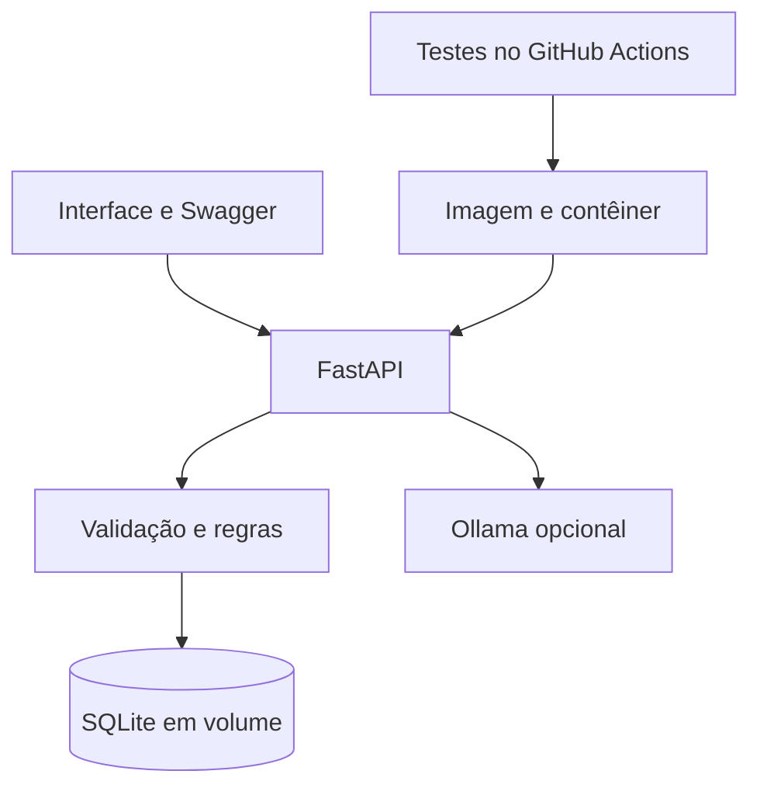

# Arquitetura e operação

A interface HTML/CSS/JavaScript e a API FastAPI compartilham a mesma origem HTTP.
O frontend envia o Bearer token e os routers validam a entrada usando Pydantic.
`crud.py` aplica regras e persiste por SQLAlchemy em SQLite. O dashboard agrega os registros.
O relatório contextual utiliza o serviço Ollama e salva somente respostas efetivas no banco.

Operação: `/health` testa a conexão SQL e retorna 503 se o banco falhar, sem detalhes internos.
`docker_start.py` exige uma chave com pelo menos 32 caracteres, lê `PORT`, prepara o diretório
do banco e executa seed apenas quando `SEED_DEMO=true`. Nenhuma chave é impressa nos logs.
O Dockerfile executa com usuário sem root. Um único processo atende à demonstração.

Persistência: SQLite com chaves estrangeiras e timeout de escrita. Reservas concorrentes usam
transação e atualização condicional de saldo. Essa implementação é específica para SQLite;
migrar para PostgreSQL exige rever as transações, não apenas alterar a string de conexão.

Limites: chave administrativa compartilhada, ausência de multiempresa e controle de perfis,
uso de Float para quantidades herdado do CP1, ausência de estudo de carga e validação sanitária.
As doações de exemplo são fictícias. A LLM apoia a análise e não modifica o estoque.
